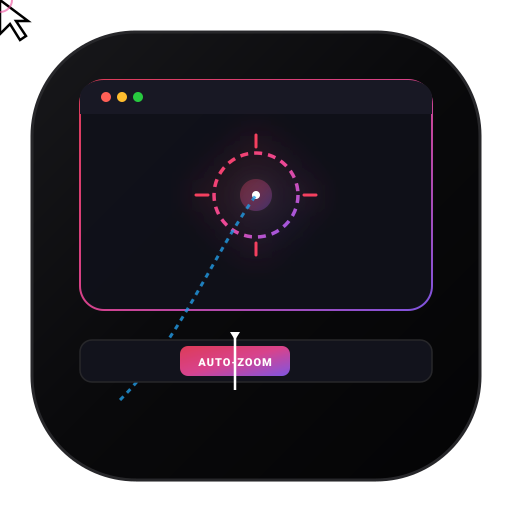
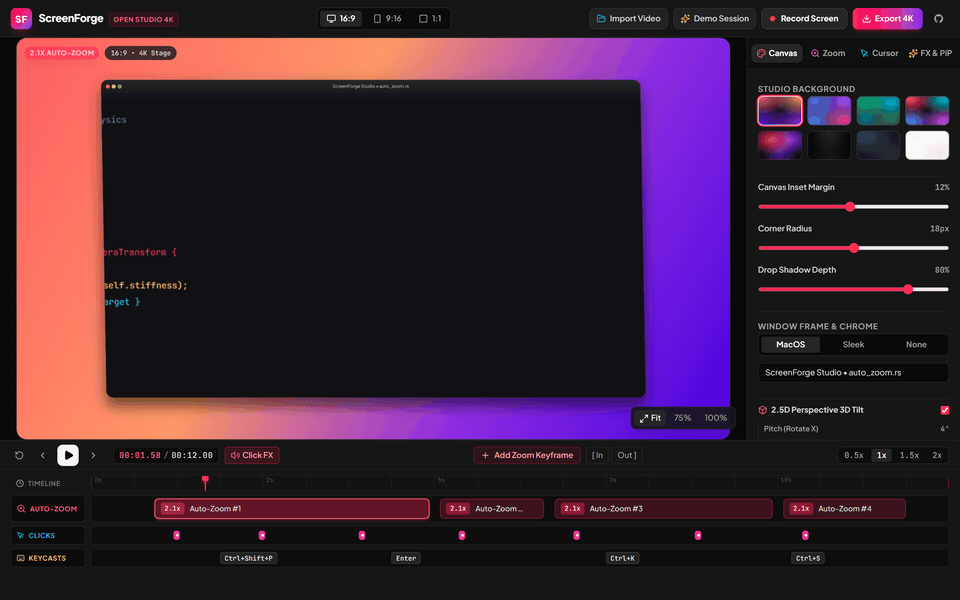
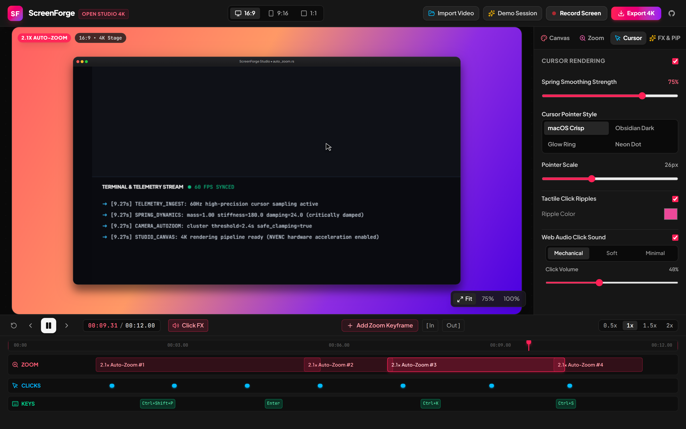
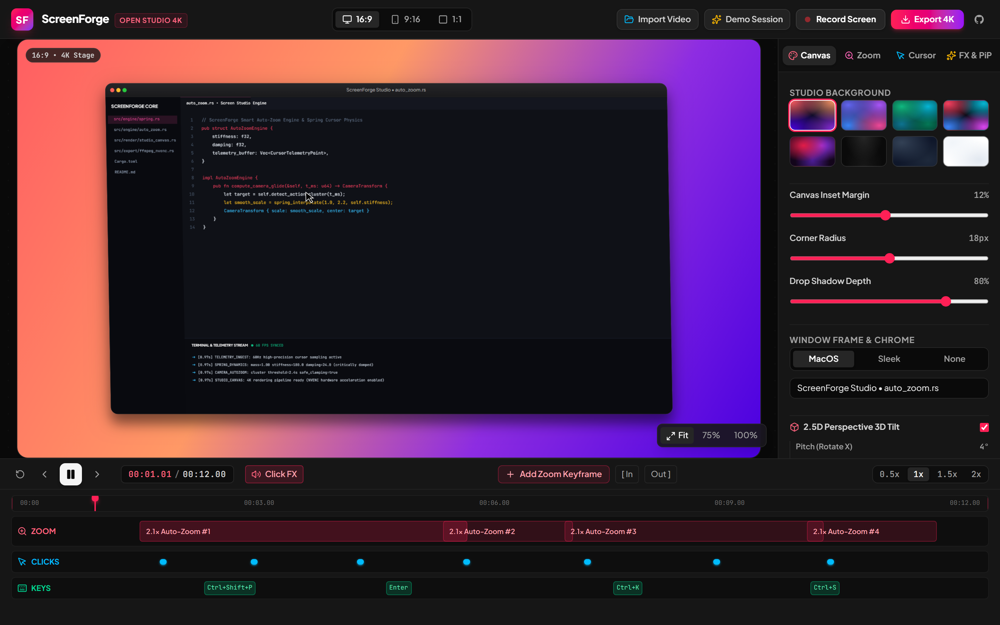
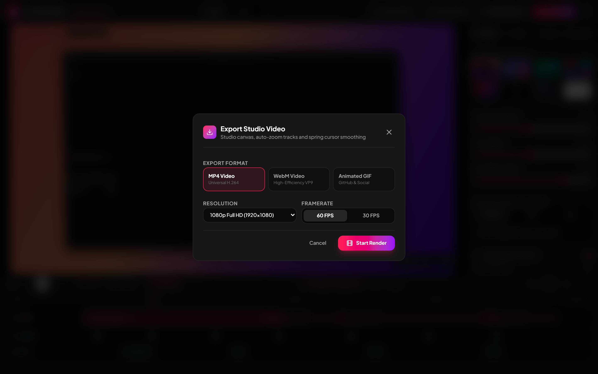

<div align="center">



# ScreenForge

**Open-source desktop screen recorder with automated click telemetry auto-zoom, spring physics cursor trajectory smoothing, studio canvas styling, keycasting HUD, webcam bubble, and 4K video export.**

[](LICENSE)
[](https://github.com/alexandrmotologa/screenforge)
[](https://tauri.app/)
[](https://react.dev/)
[](https://ffmpeg.org/)
[](https://www.typescriptlang.org/)

<br />



</div>

## Overview

Screen Studio popularized automated click zooms and smooth cursor movements for video walk-throughs on macOS, but remains proprietary and unavailable on Windows and Linux. ScreenForge provides an open-source, cross-platform alternative built with Rust, Tauri v2, React 19, and FFmpeg.

ScreenForge captures screen frames, audio, keystrokes, and synchronous mouse telemetry. In post-processing, it evaluates action clusters to automatically pan and zoom the virtual camera, smooths erratic mouse movements through damped spring physics, synthesizes tactile mechanical clicks, and nests the footage within a configurable studio canvas.

---

## Core Capabilities

### 1. Smart Auto-Zoom
- **Action Detection**: Monitors discrete mouse click, double-click, and text dwell events to identify focal regions.
- **Clustered Camera Glide**: Groups actions occurring within configurable temporal thresholds (default 2.2 seconds) to avoid rapid zoom cuts. The camera pans directly between adjacent targets.
- **Safe Viewport Clamping**: Clamps camera centers so scaled views never reveal empty letterbox borders outside the recorded display area.
- **Timeline Keyframing**: Every zoom segment is exposed as an interactive chip on the timeline for manual timing, scale, and focus adjustments.

### 2. Spring Physics Cursor Smoothing
- **Mass-Spring-Damper Simulation**: Solves second-order physical equations over raw mouse coordinate samples. High-frequency hand tremors are dampened while preserving responsiveness to intentional cursor trajectories.
- **Vector Cursor Replacement**: Replaces platform-default pointers with sharp vector arrows (macOS, Minimal Dark, Glow Ring, Neon Reticle).
- **Tactile Click Ripples**: Generates radial pulse waves on click events with configurable dissipation speed and color accents.

### 3. Studio Canvas & 2.5D Perspective
- **Aspect Ratio Profiles**: Direct output presets for 16:9 (Desktop and YouTube), 9:16 (Shorts and TikTok), 1:1 (Square), 4:3, and 4:5 formats.
- **Luxury Mesh Backdrops**: Built-in multi-stop radial and linear gradients (Sunset, Cosmic, Emerald, Cyberpunk, Velvet, Obsidian, Slate, Clean White) alongside custom solid backdrops.
- **Window Elevation**: Dual-layer drop shadows with distinct ambient diffusion and directional offset layers, adjustable corner radius, and optional macOS traffic light headers.
- **2.5D Stage Tilt**: Fine-tune pitch, yaw, and perspective depth for angled isometric presentations.

### 4. Advanced Studio FX & Presentation Tools
- **Keycasting Shortcut HUD**: Floating translucent pill displaying pressed keys and shortcut combinations (such as `Ctrl + Shift + P` or `Cmd + K`) with animated entrance and exit decays.
- **Webcam Picture-in-Picture (Talking Head)**: Circular or squircle presenter camera bubble with adjustable diameter, border glow, shadow, and corner positioning (Bottom-Right, Bottom-Left, Top-Right, Top-Left).
- **Spotlight Focus Dimmer**: Attenuates background video while preserving an illuminated focal beam around the active mouse coordinate.
- **Web Audio Tactile Click Synthesizer**: Pure Web Audio synthesis delivering mechanical switch, soft tap, or minimal click transients on mouse actions with zero external sound files.
- **Smart Idle Speed Ramping**: Detects inactive intervals exceeding threshold duration and accelerates playback by 2x or 4x to eliminate dead air without hard cuts.
- **External Video Drag and Drop**: Import any pre-recorded MP4, WebM, or MOV file directly into the studio workspace.

### 5. 4K and GIF Export Pipeline
- **Hardware Acceleration**: Bridges to local FFmpeg with NVENC, QSV, and AMF encoder detection for fast 60 FPS 4K rendering.
- **Palette-Optimized GIFs**: Two-pass palette generation using differential statistics (`palettegen` and `paletteuse` with Bayer dithering) to eliminate color banding on GitHub READMEs.
- **In-Browser WebCodecs Fallback**: Standalone client-side video encoding using MediaRecorder and canvas stream extraction.

---

## Screenshots

<div align="center">

### Studio Workbench


### Auto-Zoom Keyframe Inspector


### Spring Physics Cursor Smoothing


### Studio Canvas Gradients & 2.5D Tilt


### 4K Video Exporter


</div>

---

## Architecture

```
┌─────────────────────────────────────────────────────────────┐
│                      ScreenForge UI                         │
│  (React 19 + TypeScript + Tailwind CSS + Lucide Icons)      │
├─────────────────────────────────────────────────────────────┤
│  Studio Engine Layers:                                      │
│   ├─ AutoZoomEngine      -> Action clustering, glide curves │
│   ├─ SpringCursorEngine  -> 2nd-order damped harmonic physics│
│   ├─ ClickAudioSynth     -> Real-time Web Audio click pops  │
│   ├─ IdleCompressor      -> Inactive time speed ramping     │
│   ├─ StudioRenderer      -> Canvas compositor, PiP, Dimmer  │
│   └─ ExportEngine        -> Frame pipeline & progress state │
├─────────────────────────────────────────────────────────────┤
│                       Tauri v2 IPC                          │
│   ├─ check_ffmpeg        -> Encoder detection & capabilities│
│   ├─ get_system_info     -> OS architecture and displays    │
│   └─ open_file_in_folder -> Native shell reveal             │
├─────────────────────────────────────────────────────────────┤
│                       Rust Backend                          │
│  (tauri 2.12 + serde + tokio + native child processes)      │
└─────────────────────────────────────────────────────────────┘
```

---

## Getting Started

### Prerequisites
- Node.js 20+ (v24 recommended)
- Rust 1.85+ (Edition 2024 supported)
- FFmpeg 6.0+ installed and available on system `PATH` (optional for client-side WebCodecs export, required for native 4K NVENC rendering)

### Installation

```bash
# Clone the repository
git clone https://github.com/alexandrmotologa/screenforge.git
cd screenforge

# Install frontend dependencies
npm install

# Run automated test suite
npm test

# Launch Vite development server
npm run dev
```

### Desktop Application (Tauri v2)

```bash
# Run in Tauri desktop mode
npm run tauri dev

# Build production desktop binary
npm run tauri build
```

---

## Keyboard Shortcuts

| Shortcut | Action |
| :--- | :--- |
| `Space` | Toggle Play / Pause |
| `Left Arrow` | Step backward 1 frame (1/30s) |
| `Right Arrow` | Step forward 1 frame (1/30s) |
| `[ In` | Set timeline trim in-point |
| `Out ]` | Set timeline trim out-point |

---

## Verification & Testing

ScreenForge includes an automated unit test suite verifying zoom coordinate clamping, click clustering heuristics, idle compression, and damped spring convergence:

```bash
npm test
```

```
✓ tests/engine.test.ts (9 tests)
  ✓ AutoZoomEngine > correctly clamps center coordinates to prevent showing offscreen boundaries
  ✓ AutoZoomEngine > clusters proximate clicks into unified zoom segments
  ✓ AutoZoomEngine > smoothly interpolates camera state during transitions
  ✓ SpringCursorEngine > smoothly guides cursor position towards target without blowing up
  ✓ SpringCursorEngine > detects recent click events for tactile ripple rendering
  ✓ StudioRenderer > computes exact pixel dimensions for standard aspect ratios
  ✓ IdleSpeedCompressor > identifies inactive spans exceeding threshold duration
  ✓ IdleSpeedCompressor > boosts speed multiplier when playhead sits within an idle span
  ✓ ClickAudioSynthesizer > initializes with configurable volume and muted parameters

Test Files  1 passed (1)
     Tests  9 passed (9)
```

---

## License

MIT License. Copyright (c) 2026 Alexandr Motologa.
